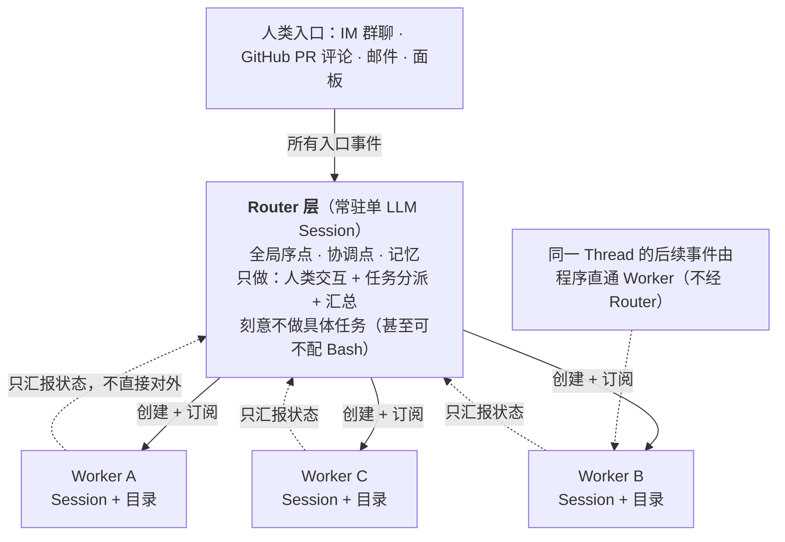
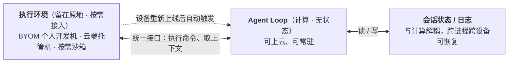
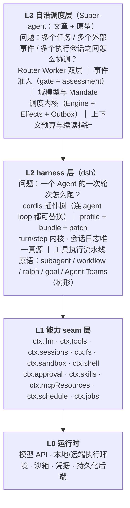

# DeepSeek Agent 架构整理：DSH 框架本体 + Super-agent 自治层

> **输入**：① 2026-10-31 DSH 团队公众号技术文章《Super-agent 设计探索：迈向更自主的 Agent 系统》（微信原文被验证码拦截，全文经[智东西转载](https://www.zhidx.com/p/606311.html)获取，属二手转述，措辞以原文为准）；② 官方开源框架 [deepseek-ai/deepseek-harness](https://github.com/deepseek-ai/deepseek-harness)（MIT，TypeScript，约 26.7 万 star）；③ 文章配套原型 [deepseek-ai/dsh-superagent-prototype](https://github.com/deepseek-ai/dsh-superagent-prototype)（MIT，TypeScript）。
> **方法**：两个仓库实际以 tarball 拉取并逐文件阅读，行号对应 `main` 分支快照；三份原始调研底稿在 [_research/](_research/)。
> **标注**：标「事实」的有仓库锚点；标「推论」的是我的判断，不作事实引用。
> **可视化版本**：同目录 [DeepSeek-Agent-架构.html](DeepSeek-Agent-架构.html)（八层结构 / 五条链路 / 边界契约，单文件可直接打开或打印）。
> **动画版**：同目录 [DeepSeek-Agent-架构动画.html](DeepSeek-Agent-架构动画.html)（数据包逐层流动，可播放/单步/切换 5 条链路）。
> **架构图（层间数据流）**：同目录 [DeepSeek-Agent-架构图.html](DeepSeek-Agent-架构图.html)（方框+分组+虚线箭头，26 组件 / 16 条流，横向布局）。

---

## 0. 结论先行

DeepSeek 放出的不是一套 Agent 产品，而是**两层可分开看的东西**，这也是整理这套架构最关键的一步：

1. **DSH（harness）= 单会话执行内核 + 无特权插件树。** 它回答的是「一个 Agent 一次轮次怎么跑」：`cordis` 插件框架上，模型适配器、工具注册表、会话日志、甚至 agent loop 本身都是可替换插件，不存在需要打补丁的特权内核。「一切皆插件」的粒度是**服务（一个 `ctx.<key>` = 一个 seam）**，不是 UI 小部件——仓库 372 个包里光 `packages/client` 就有 69 个（多为 UI 插件）。
2. **Super-agent = 在 harness 之上的一层自治调度系统。** 它回答的是「多个任务、多个外部事件、多个执行会话之间怎么协调」：常驻 Router、事件驱动 Trigger、隔离 Worker、存算分离、外部 Watchdog。它本身就是一个 DSH bundle + 插件，不另起框架。
3. **文章是设计探索，原型是参考实现，两者不等价。** 原型 README 自己写明「文章里的部分设计只是方向、原型未实现」（`README.md:5`）。逐条比对后：**双层架构、事件驱动、多信道交互 = 有实现；Inline & Spill / 链式召回、存算分离 = 部分实现；投机执行、外部 Watchdog Session、文章第 7 节的全部实验数字 = 仓库里不存在**。
4. **原型真正的工程重心不是吞吐，是「注意力成本」与「授权边界」。** 成本函数写死在 `docs/000-philosophy.md`：每条消息、每个通知、每个设置都在花同事的注意力，不划算就删掉。所以才有「只记录不执行」（`observe`）、准入表、Mandate 不可变、门控直通、100 词回复上限这些东西。
5. **一句话架构定位：`ReAct 内核（可替换）× 插件树（可裁剪）× 会话调度层（Router/Worker）× 事件准入（确定性 gate + 模型 assessment）`。** 前两项是 DSH，后两项是 Super-agent；把它们混在一起谈，是读这套资料最常见的误读。

---

## 1. 资料地图：四份东西，别混着读

| 层 | 是什么 | 核心内容 |
| --- | --- | --- |
| **L4 设计探索** | 公众号文章《Super-agent 设计探索》 | 五模块：双层架构 / 事件驱动 / 异步多信道 / 存算分离 / 外部 Watchdog；含 4 组实验数字；作者自述「是架构思路探讨，不是产品功能说明」 |
| **L3 参考实现** | `dsh-superagent-prototype`（MIT，约 2.7k★，研究原型） | 一个 DSH bundle：GitHub/飞书 → Trigger → 策略准入 → Ticket → 独立 Session + 目录执行 → 回原对话；域模型比文章更「业务系统化」 |
| **L2 自治层** | 多层会话编排长在 DSH 上的形态 | 文章 + 原型共同说明的那一层；DSH 自身**不提供** |
| **L1 harness** | `deepseek-harness`（dsh，MIT，26.7 万★，372 包） | cordis 插件树 / profile + bundle + patch 组装 / turn-step 内核 / 工具执行流水线 / 会话事件溯源 / subagent·workflow·goal·ralph |
| **L0 运行时** | 模型与执行环境 | 模型适配器（deepseek 等）· 沙箱 · 审批 · 凭据 · 持久化后端 |

**读法**：先读 L1 知道「一个 Agent 怎么被驱动」，再读 L2/L3 知道「多个 Agent 怎么被协调」，最后读 L4 知道「为什么这样设计」。反过来读会把文章里的调度假设当成框架能力。

---

## 2. 问题定义：四个特征，五处结构性矛盾

文章先给目标形态定了四个特征，这四句是整个架构的**需求书**（以下为文章原意转述）：

| 特征 | 含义 | 对架构的硬要求 |
| --- | --- | --- |
| **连续** | 用户在 IM、GitHub PR 等熟悉界面交互，感觉始终只存在一个 Agent，不必想「Session X 里有没有 Y 信息」 | 跨信道全局记忆必须落在某处 |
| **高效** | 接受新指令不必等上一条命令跑完；多个复杂任务并行 | 前台不阻塞、后台可并发 |
| **主动** | 不等逐条指令，持续观察环境事件推进值得做的事，不需要时保持安静 | 驱动输入从「人打的提示词」换成「环境事件」 |
| **持久** | 始终在线、接入真实工作环境、长期运行遇异常自动恢复 | 计算/状态/环境解耦 + 恢复机制 |

**为什么单个 ReAct Loop 撑不住**：现有 Agent 以单一 Session 为单位，多任务上限实际由**人的注意力**决定，不是由模型能力决定。往单一 Session 上堆，会同时撞到五处矛盾：

| 矛盾 | 表现 |
| --- | --- |
| 串行 vs 并发 | 单 ReAct Loop 一次只有一个在跑的任务；同步 `run()` 工具调用期间会话不响应任何新输入 |
| 连续 vs 隔离 | 全放一个 Session：上下文最连续，但细节混杂、吞吐低；全开独立 Session：吞吐高，但全局记忆丢失、结果割裂 |
| 被动 vs 主动 | 输入是「人打的提示词」，没有事件入口，就无法做「没人 @ 也能发现缺陷」 |
| 在线 vs 单机 | 计算、状态、执行环境绑在一台设备上，休眠即停 |
| 崩溃 vs 长跑 | 进程存活探测不够——大量异常不是崩溃，而是模型陷入无效循环或偏离目标 |

**推论的推论**：这五条里只有第 1、2 条是真·LLM 时代的新问题；3、4、5 条在传统计算机系统里都有成熟答案（事件循环、存算分离、Watchdog）。这正是文章反复强调「借经典系统思想」的原因。

---

## 3. 设计层：五个模块（文章）

### 3.1 双层架构：一层分派，一层干活

**结构**：常驻 **Router 层**承接所有入口的人类交互与全局协调；上下文隔离的 **Worker 层**并发执行具体任务。**Session 是系统实现细节，不是用户认知负担**——这是全文的核心论断。



**Router 层三个设计取舍**：

| 取舍 | 做法 | 理由 |
| --- | --- | --- |
| 不让 Router 成为瓶颈 | Router 不执行具体任务，只分派 | 全局节点一干活就串行化 |
| 不配 Bash | 文章原话「甚至可以不配备 Bash 工具」 | 物理上堵死「Router 自己下场实现」 |
| 用轻量模型 | 团队实践：Router 任务往往没那么复杂 | 速度与成本；其负载特征是**长输入、短输出** |

**与常见 Agent Team 的区别**（这一段最容易被误读）：

- 常见 Agent Team 用于**单个复杂任务内部**的步骤拆解，子步骤耦合紧，Team Lead 需要理解任务细节、规划子任务、高频协调，**自身推理负载很重**。
- Super-agent 的 Router 只处理**任务之间**的高层关联与分派，不介入单任务内部拆解。
- 反过来说：一个被提示词约束成「不亲自执行、只对外交互 + 分派」的 Agent Team 主会话，也可以视为这种双层架构。**差别在提示词与工具，不在框架。**

**Worker 层两条纪律**：

1. **不抢话**：Worker 不直接与人类交互，推理过程与密集工具调用不输出到外部信道，只向 Router 汇报状态，由 Router 统一回复。
2. **靠订阅自解冲突**：同层 Worker 通常不直接通信；冲突发生在同一个 PR 等共享环境里，只要都订阅了对应 Thread，就会收到相同事件并各自发现冲突，少数跨任务协同由 Router 中转。

### 3.2 事件驱动：把驱动输入从提示词换成事件

环境中半结构化的**事件**（文章称 Trigger）——群聊消息、邮件与日程提醒、代码审查评论、CI 结果——成为 Agent 的主输入。围绕一条事件的生命周期，文章给了四个递进机制：

**① 两级过滤：程序快筛 + 模型慢判**（借 Fast Path / Slow Path）

| 层 | 机制 | 特征 |
| --- | --- | --- |
| 程序层（Fast Path） | 确定性代码：事件来源、群组范围、用户/bot 白名单；不同来源分别设为「仅响应明确请求」「作为候选事件」「直接忽略」 | 低延迟、低成本，**在调模型之前**滤掉大部分噪音 |
| 语义层（Slow Path） | LLM 按提示词策略 + 上下文判断是否需要行动 | 灵活、贵；同时是**面向人的自然语言扩展点**（加减策略只改提示词） |

> 成本直觉：真实群聊与代码平台的事件流是「高噪音、低触发率」，对每条事件都调大模型判断，延迟与算力都不可接受。

**② 订阅 + 直通：后续事件不再绕 Router**

- 事件流以 **Thread** 为单位（同一个 PR、同一个 IM 话题、同一封邮件往来）。
- **未订阅（Slow Path）**：Router 仍观测所有事件以掌握全局，但只判断和分派尚未被订阅的新事件。
- **已订阅（Fast Path）**：同一 Thread 的后续事件由程序**直接发往**已订阅的 Worker，不做 Router 工具转发的 LLM 往返。若新事件超出当前任务范围，Worker 可取消订阅或交回 Router 重新分派。
- 订阅是**多对多**：一个 Worker 可订阅多个 Thread；一个 Thread 可被多个 Worker 订阅；多个 Worker 有交集时通过 Thread 事件自行协调。

**③ Inline & Spill + 链式召回：把上下文窗口当 Cache 管理**

文章的原话最值得记：「**浪费上下文窗口，就是浪费模型的智能**」。两个基本操作：

| 操作 | 含义 |
| --- | --- |
| **Inline** | 把近期很可能用到的信息直接内联进窗口，省掉工具调用往返 |
| **Spill** | 把超出预算或低频的完整信息留在窗口外，窗口内只留引用/摘要，供按需读取 |

渐进步骤（利用局部性）：从「只给对象 ID + 内容摘要」开始 → 逐步内联紧密关联对象 ID → 再内联时空相邻内容（前 50 字、前后相邻消息与被回复消息、评审讨论中相邻评论）→ 超上限则截断保留续读入口。

**链式召回**：给 Trigger、Thread、Worker Session 都赋唯一 ID，注入时内联紧密关联对象的 ID，这些对象在底层构成一张**引用图**；每次工具召回的结果同样遵循 Inline & Spill，于是返回里内联了下一跳的摘要与 ID，模型可以「从当前消息 → 所在 Thread → 相关 Worker Session → 该 Worker 关联的另一个评审 Thread」逐跳展开。这解决了 Router 在长程中丢失先前信息的问题。

**④ 投机执行：后台先试，有价值才交付**

在结果是否被采用还不确定时，按环境信号在后台提前尝试，**用额外后台算力换人的等待与介入**；结果有价值就交付，没有就丢弃。两个已上线的例子：收到会议邀约先核对日程冲突并备好草稿；群里有人反馈问题，Agent 先静默复现并找修复方案，确认问题且找到简单修法才交付，否则全程安静。

### 3.3 面向人的交互：全双工 + 按信道定制

**① 全双工**：经典 ReAct Loop 里，模型发起同步 `run()` 工具调用后循环阻塞到工具返回，期间无法响应新输入（半双工）。解法是把耗时命令与子任务工具改成异步 `start()`/`stop()`：

- 模型调 `start()` 立即收到「已启动」，循环不再等待；
- 后台完成时，结果作为**一条新事件消息**投递回会话；
- 模型可调 `stop()` 主动终止跑太久的后台命令；
- 新输入在当前推理步结束后即被处理，不必等后台工具完成。

> 文章明确：该异步任务机制**已在 DSH 中实现，但尚未默认开启**。

**② 多信道定制**（双层架构已先把冗长推理隔离在 Worker 内部）：

| 信道类型 | 交互规范 |
| --- | --- |
| IM 等即时通讯 | 低打扰轻量沟通，像人类同事一样只在需要决策/验收时通知；只问直接问题、给简短结论；**单次回复不超过 100 词**（硬性规定，已验证有效） |
| GitHub / 邮件 / 文档等异步信道 | 结构化、高信息密度的异步交付：完整体现问题背景、改动说明、验证结果 |

### 3.4 存算分离：计算、状态、环境解耦

现状：本地 Agent 把「推进 loop 的计算」「需持久化的会话状态」「代码仓库与本地工具链等执行环境」绑在同一台设备 → 休眠即停，且访问不到其他设备的环境。两步解耦：

1. **计算 ⊥ 状态**：Agent loop 与持久会话状态分离 → 摆脱单机生命周期，云端持久在线；
2. **计算 ⊥ 执行环境**：云端 loop 与「重状态执行环境」解耦 → 真实工作环境留在原地，跨设备按需接入。

文章自认这与 Anthropic 的「脑手分离」一致（harness 保持无状态、会话日志存 harness 之外、通过统一接口按需接入执行环境），**差异在场景**：Anthropic 那篇讲托管服务（按需沙箱、客户 VPC）；这里首先要接入的是**用户日常使用、可能间歇在线的个人机器**（上面有未提交修改和本地凭据）。因此既支持 BYOM（把自己的开发机接入云端 Agent），也支持云端托管机器与按需计算环境；甚至支持「设备重新上线后由云端 Agent 自动触发，完成需要在该设备执行的任务」。



### 3.5 外部 Watchdog：既盯基础设施，也盯任务进展

持久在线不能只靠主系统内部逻辑，需要在主系统**之外**加一条独立控制回路（Control Loop）：一个独立 Watchdog Session，用定时消息驱动。两类职责：

| 类别 | 检查内容 |
| --- | --- |
| 基础设施 | 接口报错、状态恢复失败等 |
| 任务本身 | 由模型判断各 Worker **是否有实质进展**、**方向是否偏离整体目标** |

发现异常及时介入修复，偶发外部故障则持续复查。因为它本身也是一个有完整工具能力的 Agent Session，维护者可以用自然语言问它故障原因，也可以让它在线改主系统行为（增删提示词、调整触发规则）。

> 关键洞察：传统进程存活探测/监控脚本**不够用**，因为 Agent 的异常大量不是崩溃，而是「模型在无效循环里但进程很健康」。

### 3.6 文章给的实验数字

条件：群聊 + GitHub CI 消息流驱动，单次约 300 条消息、其中约 20 条工作请求，编码工作用只耗时工具代替，每种方案跑 5 次；合成负载与简化环境，作者自述仅作初步参考。

| 指标 | 结果 | 读法 |
| --- | --- | --- |
| p50 / p95 完成时间 | **12.4 min / 15.7 min** | 显著优于「带 Subagent 工具的单 Session」 |
| 单 Session 对照 | 中性提示下 5 次运行一次都没委派 Subagent，p95 达 **29.5 min**；改成「优先委派」后 5 次有 4 次委派，仍慢于 Super-agent，剩余 1 次模型判断工作「很小」自己干 → 长尾 | 单 Session 的表现对提示词极其敏感 |
| 去掉订阅直通 | 完成时间基本不变；Router 决定数 **+30%**，读缓存 token **2,323 万 → 3,177 万（+37%）** | 直通不提速，但为 Router 省下可观 token 与推理开销 |
| Router 批处理压测 | Trigger 到达 1 → 40 条/分，平均 batch **1.0 → 2.8**，单次请求耗时 2.5s → 3.9s（增长远慢于 batch），**单决定分摊 6.4s → 1.6s** | 积压越多，单个决定越便宜；上限取决于上下文长度与一轮能准确处理多少条 |
| 总账 | 「拿更多 token 换时间与稳定性」 | 不是免费加速 |

**机理**：Router 每步是长输入、短输出；把积压的多条 Trigger 合并进一次 LLM 调用，在 Prefill 阶段并行计算，单次请求耗时增长远慢于批处理大小。

---

## 4. 实现层：原型把「设计」翻译成了「业务系统」

原型不是把五个模块写一遍，而是把它落成一个**带授权边界的工单系统**。这是文章与代码之间落差最大、也最有价值的部分。

### 4.1 域模型：Source → Trigger → Thread → Eval → Ticket+Mandate → Assignment → Executor

```text
 Source ──Trigger──▶ Thread ──┬─▶ Eval ──accept(with Mandate)──▶ Ticket
   ▲  (事件流)      (时间序)   │      │                            │
   │                          │      └─ignore/unavailable─▶ 记录   │ Assignment
   │                          └─▶ 订阅扇出(Subscription)──────────▶ │
   │                                                               ▼
   └──────────────── Channel ◀──────────── 结果/回复 ────── Executor（Worker Session + 目录）
```

核心概念与它们各自「守的规则」（`docs/001-domain.md:25-37`）：

| 概念 | 定义 | 守的规则（为什么存在） |
| --- | --- | --- |
| **Source** | 事件流；kind 是可复用实现，instance 是一种配置 | 持有读位置与自己的 bot 身份；**在进入领域前**丢掉 bot 自己的消息与不在收听范围的 Trigger；重启不能重放事件 |
| **Trigger** | 一条不可变事件 + Source 元数据 | 属于一个或多个 Thread；**同一 Trigger 被接受两次只产生一个 Ticket**（幂等与审计的单元） |
| **Thread** | 时间序的 Trigger 序列 | **同一 Thread 同时最多一个 Eval**；可挂多个 Ticket；持有订阅与决策历史 |
| **Eval** | 对一个 Trigger 批的判定，**两层：gate + assessment** | 无状态；输入 = 批 + Thread 快照 + 该 Thread 全部 Ticket + 当前 Policy |
| **Mandate** | accept 授予的东西：Policy 版本、范围、强度、匹配规则、发送者身份、接收方式 | **不可变**；范围变大必须开新 Ticket；Ticket 结束不结束它，只有人 stop 或 Policy 不再成立才失效 |
| **Ticket** | 授权工作的单元 | 只有 Eval 能创建；`open → ended`，人的消息可拉回 open；**自己定义状态，不跟随 Executor** |
| **Assignment** | Ticket 与一个 Executor 实例的绑定 | 与 Ticket 独立地 `pending → running → ended`；只有最终 Report 能结束 Ticket |
| **Subscription** | Ticket ↔ Thread 多对多，由 Thread 持有 | 匹配 Trigger **无差别**扇出给所有活着的订阅 Ticket；**绕过 gate、不授予新权限**，只受既有 Mandate 限制 |
| **Channel** | Thread 的写侧 | 回执、回复、PR、已解决 review 都是「写」 |

**被显式否决的概念**（`docs/001-domain.md:45-60`）比概念表更能说明设计品味，三条最有信息量的：

- 否决「Ticket 状态跟随 DSH Session 状态」——Ticket 可移交、恢复、由多个 Executor 执行，所以它必须自己定义状态；
- 否决「Policy 变更时取消运行中的 Ticket」——取消会留下半成品，正确做法是**记录变更并送达受影响的 Ticket**；
- 否决「从 Report 的自由文本推断『在等人』」——分类需要结构化事实，Executor 必须通过结构化字段提问。

> **推论**：这套域模型的重心是**可审计**（每条 Trigger 都有 disposition 记录去了哪、为什么）与**可撤销**（Mandate 三变），而不是性能。它更像「把 Agent 当同事接入组织流程」，而不是「把 Agent 当函数调用」。

### 4.2 授权：确定性 gate + 模型 assessment，默认只记录不执行

文章说的是「两级过滤」，代码里是**两段式 Eval**：

| 段 | 属性 | 职责 |
| --- | --- | --- |
| **gate**（`src/policy.ts:191-211`） | 确定性代码 | 判「谁可以发起工作、以什么强度」：非人类事件走 `machineGate`（只放行白名单 bot / 无发送者的 CI，其余 `not_human`）；人类事件依次判「名单内 + 点名 = explicit」→ 准入表单元格 → Thread follow-up → 表格 inferred → 拒绝码 |
| **assessment**（`MasterAssessor`） | 模型 | 判「这条事件是否值得开工、开工范围多大」：必须覆盖每条 enabled 规则一次、方向已定、至少一条规则匹配、必须有 `intent_evidence` |

**三种 accept mode**（`src/policy.ts:83-87`）：

| 模式 | 行为 | 用途 |
| --- | --- | --- |
| `off` | 不做任何推断接受 | 只接明确请求 |
| **`observe`（默认）** | 推断候选即使评估正向，也只记 `would_accept`，**不接单** | 灰度上线路径：先看「它本来会做什么」对不对 |
| `auto` | 匹配规则且 enabled 时可自动接单 | 真·主动 |

**准入表**（`docs/002-authorization.md:56-75`）：每个 Source 的 Policy 有一张表，行 = 接收范围（飞书按群/私聊；GitHub 按新 Issue/新 PR/评论/默认分支 CI），列 = 三个单元格（在名单未点名 / 不在名单但点名 / 不在名单且未点名），取值 `explicit | inferred | ignore`。**推断工作只能在 `auto` + 规则 enabled 时被接受**，`observe` 下永远只记录。

**Mandate 只有三条路径会变**（`docs/002-authorization.md:129`）：accept 创建、人 stop 撤回、revalidate 失败吊销。而且**Executor 不能宣称「有人让它停」**——stop 必须由 Eval 判定或面板命令，这一条把「Agent 自说自话」的路堵死了。

> **这一层是文章里最没展开、原型里最厚的一层。** 文章讨论「什么时候该主动」，原型回答的是「主动的授权从哪来、能到什么范围、怎么收回」。

### 4.3 执行：一 Ticket 一 Session 一目录

| 机制 | 事实 |
| --- | --- |
| 会话与目录 | 每 Ticket 一个 `worker-<ticket id>` Session + 一个目录，默认根 `<stateDir>/work`；目录名 = 短名 + id 前 12 位（`docs/003-execution.md:25`、`src/executor/dsh.ts:24,110`） |
| 准备命令 | 首次 launch 前跑一次 `prepare`（`sh -c`，10 分钟超时），典型内容是 `git worktree add`；**失败即失败工单且不自动重试**（`docs/003-execution.md:51-53`） |
| 并发 | `maxWorkers` 默认 **3**（1–16），**额外 1 个槽位专供人的消息/状态查询**，且「唤醒优先于新 launch」（`src/policy.ts:93`、`docs/003-execution.md:59`） |
| 后台工作预算 | turn 结束后若还有 shell job/subagent 在跑，**继续持有槽位**；最多 30 分钟，超时杀 shell job 报 waiting，subagent 允许继续（`docs/003-execution.md:33-39`） |
| 执行环境 | 是**变量抽象**不是沙箱：`EXECUTOR_VARIABLES` 注册 `DSH_SUPERAGENT_DIR/NAME/TICKET/BLOCKED_COMMANDS`，Source 再注册自己的变量；文档明说「这些 wrapper 与目录只提供默认值，**不是安全边界**」，Worker 仍可按绝对路径执行程序（`docs/003-execution.md:80`） |
| 失败语义 | 瞬时失败（供应商/网络/408/429/5xx）先重试 3 次、退避 15s 起翻倍；**重试 = 结束当前 Assignment，在同一 Session/目录/分支/PR 上起新的**（`docs/003-execution.md:141`） |
| 重启恢复 | 运行中的 Assignment 以 "host restarted" 结束，新 Assignment 带 recovery note 要求**先核对目录/git 历史/GitHub 再重做外部动作**，最旧 Ticket 优先（`docs/003-execution.md:146`） |

### 4.4 调度内核：单写者 Engine + 持久 Effects + Outbox

原型最「系统化」的地方在这里，也是文章完全没提的部分：

| 组件 | 作用 | 关键约束 |
| --- | --- | --- |
| **Engine**（`src/core/engine.ts`） | 唯一能写 Trigger/Thread/Decision/Ticket/Assignment 的地方 | 所有方法**同步**；每个命令一个事务；端口在事务内 `enqueue`，适配器在提交后执行（`docs/007-architecture.md:44-50`） |
| **Effects**（`src/app/effects.ts`） | 持久副作用队列（**先落库后执行**） | 6 种 kind 各有并发上限与退避：`assessment` 4 / `launch` = 空闲槽位 / `delivery` 4 / `relay`·`notice`·`reply` 各 1 且**保序**（`docs/007-architecture.md:172-181`） |
| **Outbox**（`src/app/outbox.ts`） | 对外消息的唯一写者与回执 | 一条消息的「投递」与「回执入队」在同一事务；同一 Ticket 同一会话的消息按队列顺序发出（`docs/003-execution.md:177-191`） |
| **Store**（`src/app/store.ts`） | 单 SQLite 文件 `<stateDir>/orchestrator.sqlite` | 9 张表（trigger/disposition/trigger_thread/thread/ticket/decision/effect/outbox/kv）；生成列 + 索引让每轮只读活跃工作；启动先拿目录锁防双进程 |
| **Passes**（`src/app/passes.ts`） | 每 2 秒（以及命令触发时）跑一次 | 一次只跑一个 pass：先处理到期 effects，再 `evaluateDue` |

**已知欠账**（文档自己写的，`docs/007-architecture.md:484`）：**没有任何删除逻辑**，`trigger / disposition / decision`、已结束 Ticket 与 Thread、outbox 回执、KV 里每个 settings/prompt 版本都会无界增长。

> **推论**：这套「Engine 单写者 + Effects 持久队列 + Outbox 回执」是典型的**事务性工作流引擎**做法，而不是 Agent 框架的常见做法。它换来的是崩溃可恢复、消息不重不漏、可审计；代价是复杂度与存储成本。

### 4.5 上下文：字符预算 + 续读指针 + 资源引用图

文章说的 Inline & Spill / 链式召回，在代码里是「用字符上限 + `read` 指针 + 资源页」隐式实现的（**全仓 grep 不到 `Inline & Spill` 或 `speculat`**）：

| 机制 | 实现 |
| --- | --- |
| 评估窗口 | 硬编码字符预算：Trigger 本体 4,000 字符、紧邻两条各 1,200、窗口其余 400、未加载消息只给 50 字符 stub；窗口 = Thread 前 5 条 + Trigger 前后各 5 条（`src/app/assessment.ts:37`、`docs/007-architecture.md:542-546`） |
| Spill 侧最小实现 | 截断一律带续读入口 `{text, chars, read: '<resource>'}`（`src/executor/dsh.ts:113-116`） |
| 链式召回的骨架 | 资源页只暴露「能通过某个资源读到」的 id：「Every id a page shows reads through one of these, so a Session walks from one object to the next」（`docs/007-architecture.md:575`）；文本页默认 4,000 / 最多 8,000 UTF-16 单元，列表默认 20 / 最多 50 条 |
| 读缓存 | 进程内 LRU（按 UTF-16 总量裁剪），**重启即失**；分页游标必须从 offset 0 重读（`src/app/cache.ts:1-27`） |
| 注入方式 | 不是拼上下文，而是**消息**：Assignment/Input 以 JSON 卡片随消息送达，首条消息含标题、≤1,500 字符 assignment、源 Trigger 卡 |

> **与文章的差别**：文章描述的链式召回是「注入时内联下一跳 ID、召回时自动带出再下一跳」，原型只做到「模型可以逐跳调用 `orchestrator_read` / `orchestrator_eval_read`」，**更依赖模型主动性**。

### 4.6 Router 与 Worker 的约束是靠什么实现的

这是「双层架构」在代码里最值得抄的细节：

| 约束 | 实现手段 | 锚点 |
| --- | --- | --- |
| Router 不写实现计划 | 提示词 + 反例：「Could we add a dark mode?」不应被 Router 变成配色方案 | `prompts/dispatch.md:41` |
| Router 不读代码 | 提示词规则（**不是**工具裁剪） | `docs/007-architecture.md:507`（自述 "a prompt rule, not a tool restriction"） |
| Router 不等结果 | `noWait` 守卫：拒绝主 Session 的 `sleep`、>30s shell 超时、>5s job 等待 | `src/app/sessions.ts:72-77` |
| Router 批量分派 | `orchestrator_route` 一次接受 **1–20 条**决定，每条独立执行、互不阻塞 | `src/app/tools/main.ts:122-129` |
| Router 转发不改写 | 路由 note **≤30 词**（按中文分词计数）；必须用原始 trigger ID | `docs/004-prompts.md:77` |
| Worker 不抢话 | Worker 预设去掉「问人/展示/plan/调度/goal/workflow/forked subagent」等工具；只保留文件/搜索/shell/job/web/skill/todo/subagent | `cordis.patch.yml:13-74`、`src/app/sessions.ts:61` |
| Worker 越界要交回 | `orchestrator_trigger_handback` → Engine 记 handbacks → **等没有其他 Ticket 拥有它**才排新 Eval | `docs/007-architecture.md:91` |

**与文章的一处明确偏离**：文章说 Router「甚至可以不配备 Bash 工具」，原型**仍然给主 Session 配了 bash/read/skill/job**，靠提示词 + `noWait` 守卫约束。这是原型自己承认「工具级隔离没做完」的地方。

---

## 5. 逐条对照：文章设计 vs 原型代码

这是整份资料里**最容易被误读的一节**，也是判断「该抄什么、别抄什么」的依据。原型 README 已明确划线：「文章里的部分设计只是方向，原型未实现」（`README.md:5`），以下是逐条核验结果。

| # | 文章设计 | 原型状态 | 判定 | 关键锚点 |
| --- | --- | --- | --- | --- |
| 1 | 双层架构：常驻 Router + 隔离 Worker 并发 | 单 main Session（id 持久化在 KV `master-id`）+ 每 Ticket 一个 `worker-<id>` Session/目录；Router 靠提示词 + 工具集 + `noWait` 守卫只路由 | **有实现** | `src/app/runtime.ts:104-105,210`、`prompts/orchestrator.md:1-4`、`docs/003-execution.md:25` |
| 1b | Router「甚至可以不配 Bash」 | 主 Session 仍有 bash/read/skill/job；文档自述「这是提示词规则，不是工具限制」 | **未实现（有意偏离）** | `docs/007-architecture.md:507`、`src/app/sessions.ts:72-77` |
| 2.1 | 两级过滤：程序 Fast Path + 模型 Slow Path | `policy.gate()` 确定性准入 + `MasterAssessor` 模型评估；三种 accept mode 支持「只记录」 | **有实现** | `docs/001-domain.md:90-91`、`src/policy.ts:167-211` |
| 2.2 | 订阅 + 直通：已归属的后继事件不经 Router | `Intake` 按 Thread 扇出到订阅 Ticket，不产生 candidate；Router 只见 follow-up 通知 | **有实现** | `src/core/intake.ts:38-59`、`docs/002-authorization.md:20-22` |
| 2.3 | Inline & Spill | 字符/条数硬上限 + `{chars, read}` 续读指针 + 资源页分页 + LRU 读缓存；**没有独立的预算管理器，也没有以 Inline/Spill 命名的组件** | **部分实现** | `src/app/assessment.ts:37`、`src/executor/dsh.ts:113-116`、`docs/007-architecture.md:550-577` |
| 2.4 | 链式召回（注入内联下一跳 ID，自动逐跳） | 资源页只暴露可读 id，模型用 `orchestrator_read`/`orchestrator_eval_read` **手动**逐跳；注入端不自动展开 | **部分实现** | `docs/007-architecture.md:575`、`src/app/assessment.ts:67-82` |
| 2.5 | 投机执行（后台预跑，有价值才交付） | 全仓 `speculat` **零命中**；最接近的只是「问状态」与「后台作业结束唤醒」，均非预跑方案 | **未实现** | grep 0 命中；对照 `docs/007-architecture.md:489-508` |
| 3 | 异步多信道：全双工 + 按信道定制 | 回复走 durable outbox（不阻塞轮次）；两个 Channel（GitHub 评论/review thread、飞书 topic）；**100 词硬限**并按中文分词计数 | **有实现** | `docs/003-execution.md:177-191`、`prompts/replies.md`、`src/infra/text.ts:2-14` |
| 4 | 存算分离 + 执行环境解耦（云端常驻、跨设备） | SQLite 单库 + DSH session 持久化 + 每 Ticket 目录/变量；**单机单进程 + tmux**，无云端 loop、无跨设备、无间歇在线接入 | **部分实现（只做到第一层）** | `docs/007-architecture.md:452`、`docs/006-deployment.md:5-19` |
| 5 | 外部 Watchdog Session（模型判断进展/方向） | 全仓 `watchdog` **零命中**；等价物只有 (a) 每部件一个 HealthBoard 条目，(b) 另一个 profile 里的**每小时 cron** 跑 `status` 按退出码决定重启 | **未实现（无 LLM Watchdog）** | `docs/007-architecture.md:269`、`docs/006-deployment.md:133-141` |
| 6 | 文章第 7 节实验（p50/p95、token、批处理） | 仓库无基准负载、消融脚本或数据（`12.4`/`2323`/`3177` 等零命中） | **不在仓库/无法核对** | grep 0 命中 |

**三条最容易被误读的点**（建议记牢）：

1. **「Router 批处理摊薄到 1.6s」在原型里不是显式的 batch 合并代码**，而是「candidate 以消息 steer 进 main Session 的 turn、turn 内到达的 relay 在下一 step 一并投递」的行为副产物（`docs/007-architecture.md:42`）。原型里真正显式的「批」在**评估侧**：同一 Thread 的排队 Trigger 合成一个 Eval，一次 `orchestrator_route` 可带 1–20 个决定。
2. **「投机执行」在原型里的对应物不是实现，而是策略**：`observe` 模式只记录「本来会做什么」。这是「先算不交付」的**策略版本**，不是后台预跑。
3. **Watchdog 在原型里被拆成两种东西**：机器可判的**健康板**（进程/部件/effect 失败）+ 外部 cron 巡检；「由模型判断 Worker 是否偏离目标」这一层不存在。

---

## 6. 底座：DSH 框架本体的架构

要把 Super-agent 放对位置，必须先看清它长在什么东西上。

### 6.1 cordis：五个概念撑起「一切皆插件」

| 概念 | 含义 |
| --- | --- |
| **插件** | 实现 Service 的对象：带可选 `inject` + `apply(ctx)` 的函数，或 `Service` 子类；生命周期由 Cordis 挂载到上下文 |
| **上下文** | 服务的容器。一个服务占据稳定的 `ctx.<key>`（`ctx.tools`、`ctx.llm`、`ctx.sessions`…）；**其他插件按 key 查找服务，而不是导入具体实现** |
| **inject** | 声明服务依赖后等待其就绪；**加载顺序由服务依赖表达**，不手工编排启动序列 |
| **类型化事件** | TS 声明合并注册事件名，五种分发模式：`emit`（纯观察）/ `waterfall`（环绕中间件，不调 `next()` 即短路）/ `parallel` / `serial` / `bail` |
| **可逆副作用** | 提示词片段、工具 schema、适配器、监听器都通过 `ctx.effect()`/`ctx.on()` 安装，**reload 与 teardown 时撤销** |

**「一切皆插件」的确切粒度**：不是「工具/模型/UI/渠道」这种产品功能切分，而是**一个 `ctx.<key>` 服务 = 一个可替换 seam**。架构文档原话：「产品的每一部分都是插件，包括模型适配器、工具注册表、会话日志，以及 **agent loop 本身**，因此每个都可以从配置替换」「**不存在需要打补丁的特权内核**」。

**seam 是三段式能力**（`docs/glossary.zh.md`）：Service Definition（拥有 `ctx.<key>`，是抽象类或具体注册表，**绝不是 TS interface**）+ 一个或多个 Provider + 一个或多个 Consumer。规范范例：`dsh-shell`（Definition）+ `dsh-bash-local`/`dsh-bash-sandbox`（Provider）+ `dsh-tool-bash`（Consumer）。

> **注意一个反例**：`packages/core/scope` 是唯一非服务包（零依赖库），位置刻意放在 `session/`、`system-prompt/` 之下就为了**避免循环依赖**。「无特权内核」不等于「没有分层」。

### 6.2 组装：profile + bundle + patch，配置即构成

```text
空条目列表
 → profile 的有序组合包（package.json 的 dsh.profile.bundles）
 → profile 自己的 cordis.patch.yml
 → home 级 $DSH_HOME/cordis.patch.yml
 → --patch overlay
```

**patch 按 id 定位条目并替换其整个 config，不做深合并**——所以每层要「重述想保留的每个设置」。

| profile | 组合包栈 | 形态 |
| --- | --- | --- |
| `web` | `dsh-base` + `dsh-web-app` | 浏览器 GUI（默认 `127.0.0.1:3080`），启用配置 HMR |
| `headless` | `dsh-base` + `dsh-headless` | 一次性任务，打印结果即退出；**不开端口、不留后台物** |
| `sdk` | `dsh-base` + `dsh-sdk-app` | JSON-RPC stdio，供 TS/Python SDK |
| `acp` | `dsh-base` + `dsh-acp-app` | 纯自动化 ACP stdio |
| `sdk-minimal` | 仅 `dsh-sdk-minimal` | **刻意例外**：一棵完整显式树，不应用 `dsh-base` |

`dsh-base` 本身**是一份静态 patch 文档**：「应用到空 profile 根之上的 `insert` 列表，不挂载任何服务、不发出任何事件、不持有任何可变状态」。

> **这条设计的含义**：产品的形态差异是**声明式的**，代码里没有 `if (profile === 'web')`。`dsh --profile web --dump-config` 能把生效配置树整棵打出来，任何一行都可以被自己的 patch 替换——这是「可审计的插件树」，不是「黑盒框架 + 钩子」。

### 6.3 内核：turn / step 两层抽象

- **step** = 一次模型请求 + 由响应引发的工具执行。
- **turn** = 一次对已接纳输入的**排空过程**，包含 0 个或多个 step。
- **Round** = 承载一个 turn 的外层策略迭代（Goal Round、Ralph 尝试）；计数器归策略所有，**不统计会话里的每个 turn**。
- **交互段（exchange）** = 连续 turn，从首个接真人输入的 turn 起算；被通知唤醒的 turn 归入前面的交互段。

一个 turn 流经**六个包**：`agent-loop` driver 认领输入 → 在 `session` 日志上开 turn → `system-prompt` 组装前缀、从日志派生历史 → `llm` seam 流式请求 → `tools` 注册表分发 → 每个模型可见事实追加回日志供下一步派生。

| 包 | 职责 | `ctx` 键 |
| --- | --- | --- |
| `core/session` | 仅追加的 `SessionEvent` 日志 + 内存 store（**唯一真源**） | `ctx.sessions` |
| `core/system-prompt` | 提示词片段与工具 schema 组装 | `ctx.systemPrompt` |
| `core/tools` | 作用域化工具注册表 + 带把关的执行流水线 | `ctx.tools` |
| `core/agent` | `Agent` 接口、活跃注册表、`agent/*` 事件 | `ctx.agents` |
| `core/agent-loop` | 实现该接口的默认驱动器（**可替换**） | `ctx.agentLoop` |
| `core/scope` | 按 agent 划分作用域的注册原语 | 库，无 ctx 键 |
| `llm/llm` | 消息与流式词汇表 + 适配器 seam | `ctx.llm` |

**事件三域**（选对事件域是「改 dsh」的第一个决定）：

| 域 | 用途 | 例子 |
| --- | --- | --- |
| **会话事件** | 必须**在重新加载后仍然存在**的持久事实 | `turn/*`、`step/*`、`user/message`、`assistant/message`、`tool/call`、`tool/result` |
| **Agent 事件** `agent/*` | **观察或拦截进行中的工作** | `agent/pre-step`（waterfall）、`agent/request-error`、`agent/turn-stopping`（serial）、`agent/status`、`agent/inbox/{inserted,claimed,discarded}` |
| **能力事件** | 向某个 seam 附加策略与适配器，无需导入循环 | `fs/*`、`tools/*`、`telemetry/*` |

**关键不变量**：**「模型可见即已记录」**——每个模型请求都必须能从会话日志重建；压缩（compaction）只**隐藏被取代条目，不删除**，日志保留全部历史（`packages/core/session`）。

### 6.4 工具执行流水线：把安全与策略插在「不碰循环」的位置

```text
assistant 消息里的 tool-call 块
 → tool/call 会话事件（执行前先记录）
 → tools/pre-execute waterfall（hooks / 权限 / 沙箱）→ 可 deny / ask
 → 注册的单调 guard（deny 或弃权，身份受保护）
 → ctx.approval 一次性询问（缺失或无法回答 = 拒绝）
 → tools/execute waterfall（timeout / retry / metrics，环绕分发）
 → 工具 body → fs/write-intent / fs/edit-intent 门禁
 → 工具自有会话事件（todo/write、fs/observed…）
 → projectContent（执行准备后的文本与图像）
 → tools/post-execute waterfall（accept / block / replace / add context）
 → finalizeContent → tools/result 同步通知 → tool/result 会话事件
```

**规模**：文档统计 35 个工具包 / 76 条工具 schema；分类覆盖文件、shell、终端、web、MCP、委派、编排（`workflow`/`ralph`）、目标与计划、调度、后台作业、PTC（`run_code`）、会话检索、UI 呈现、Cordis 自省、浏览器等。

> **可抄的一条**：策略与安全放在**event 上**而不是改循环里——「拦截和策略优先使用事件；直接能力调用优先使用服务方法」。这是插件化 agent 框架能长期维护的关键手法。

### 6.5 多 agent 原语：树形委派，不是自治社会

| 原语 | 形态 | 关键约束 |
| --- | --- | --- |
| **subagent** | 9 个包，统一 `startActivation`；6 个后端：in-process spawn / fork / claude-code / codex / dsh-sdk / acp | `delivery: 'parent' \| 'caller'`；控制工具 `send_message`/`interrupt_agent`/`list_agents` |
| **subagent_oar**（v0.2.2 实验） | 内嵌 OAR 库，**一个 `subagent_oar` 工具 + 运行时选择**（`oar-codex`/`oar-claude`…） | 把「多后端委派」从「多个工具名」收敛为「一个工具 + 选择」 |
| **Agent Teams**（实验） | 持久 roster + 任务 DAG + 直接 inbox；`TeamId` 就是 root `SessionId` | `writeScopes` 是**提示性路径前缀，不是锁**；成员从 `provisioning` 到 `active`/`failed`；**`dsh-base` 默认禁用**；不支持独立工作目录/跨进程协调 |
| **workflow** | 用纯 JavaScript 编排脚本扇出 subagent（`agent`/`parallel`/`pipeline`/`phase`/`log`） | **阻塞父轮次到工作流结算**；模型只看到最终 JSON，**永远看不到中间子 agent 消息**；结果不拒绝（失败兑现 `stopReason: 'error'`） |
| **ralph** | 固定前台循环，每 Round 一个**全新子 agent**，只有一份有界结构化报告跨越 Round | 子 agent **不继承父对话种子**；调用阻塞到结算；终态 `complete`/`blocked`/`budget-limited` |
| **goal** | 同会话持久目标，跨恢复/fork/重启存在 | 自述「**存储状态但不调度工作**」，续行权限是**进程本地**的；`armed`/`disarmed` 故意不参与持久回放 |

**共同约束**：所有子 agent 都是**会话**（有 `parentSession`）；**作用域不继承**父级注册（只有两层：全局 / 带作用域），子树行为靠 lineage 数据表达；委派深度是数据（`delegationDepth`/`subagentDepth`），不是能力继承。

### 6.6 关键判断：DSH 没有「长期在线·事件驱动·多会话调度」这一层

这是把两层分开的最后一块拼图。证据：

| 检查项 | 事实 |
| --- | --- |
| 文档关键词 | 「长期在线 / 常驻 / 守护·daemon / 事件驱动 / 多会话 / 无人值守」在 22 篇中文文档中**全部 0 命中**；「调度器」只出现在否定句（「目标……不是调度器」） |
| 内核状态 | Agent 只有 **`idle` / `running`** 两态，没有持久状态机，没有 `paused`/`daemon` 形态 |
| 绑定关系 | 每个 Agent 恰好绑定一个 Session；`create()`/`resume()` 返回句柄，`dispose()` 是「只有持有者能拆除」的能力 |
| 活跃性来源 | 由**输入三动词**驱动：`followup()` 排队下轮提示词、`steer()` 提交下一步输入、`inject()` 加上下文但**不唤醒**；没有「内部时钟 + 自主 tick」 |
| 宿主级适配器 | `ctx.schedule`（独立于 Session 激活状态的宿主任务，七种时间类型，**但 Host 必须运行**）、`ctx.webhookRuntime`（唯一内置动作是**创建普通根会话**，不等待 idle、不检查回复）、`ctx.jobs`（后台 shell，结束时 `inject()` 通知）、`ctx.connection`/API Gateway（多会话浏览与操控面） |

> **结论（推论）**：dsh 是**「事件驱动的入口」，不是「事件驱动的运行时」**；定位应是「**可插拔的单会话执行内核 + 产品化的宿主外壳**」，而非常驻自治体。这正是 Super-agent 要补的那一层——**它不是在重写内核，而是在内核之上加了「状态归属、活跃性来源、多体结构」三样东西**。

### 6.7 运行时抽查：文档 vs 本机安装版（Desktop 0.2.1-rc.5）

文档说得好不代表装出来就是这样。本机（本文写作时的运行环境）实测结果——**8 条关键论断全部成立**，另有 3 处「文档没写但真实存在」的东西：

| # | 文档论断 | 本机结论 |
| --- | --- | --- |
| 1 | 产品每一部分都是插件（含模型适配器、工具注册表、会话日志、agent loop） | ✔ base patch 里 `llm-deepseek`、`tools`、`session-persistence-jsonl`、`agent-loop` 都是普通行；`ctx.tools.register()` 返回 `unregister()` |
| 2 | 层序 bundles → profile patch → home patch → `--patch`，且「一条 patch 替换整个 config」 | ✔ 源码注释逐字命中：`Bundle, profile, home, and CLI layers apply in that order. A patch config replaces the whole config.` |
| 3 | 内置模板只有 web/headless/sdk/sdk-minimal/acp | ✔ 一致；但本机还有 `desktop`（Electron 独占，CLI 明确拒绝）与 `superagent`（本地原型）两个非模板 profile |
| 4 | HMR 由 YAML 控制（base 开、headless/sdk/acp 关、sdk-minimal 不含） | ✔ |
| 5 | 桌面 = Electron-Node 起私有 Host，Host 跑完整 Web 应用，端口系统分配 | ✔ 实测 `--port 0` → `127.0.0.1:59904`；`curl` 未授权访问返回 **401**（`dsh web authentication required`） |
| 6 | 核心 ctx 键 `sessions`/`systemPrompt`/`tools`/`agents`/`agentLoop`/`llm` | ✔ asar 内逐一命中 |
| 7 | Agent Teams 需显式启用 `ctx.agentTeams` | ✔ 本机由 `dsh-experimental-agent-team-profile` 显式加入，**base 默认不含** |
| 8 | 会话日志 v1 起用 `session.vN.jsonl[.zstd]` | ✔ 本机同时存在 `session.v4` / `session.v3` / 无版本号三代文件 |

**文档没写、但实测值得知道的三件事**：

1. **工具数是三层，不是一个数。** 代码内可定义工具 ≈59 个（53 个静态名 + 5 个名字由 config 决定的 `subagent*`/`workflow` + `exit_plan_mode`）；profile 默认挂载约 50 个；**单个会话实际可用数由 agent preset 决定**（本次写作会话是 47 个）。「加个工具就能用」在 DSH 里是错的，还要过 preset 授权。
2. **「一切皆插件」在装机形态上是可量化的**：桌面运行时 305 个依赖里 **297 个是 `@deepseek-ai/dsh-*` 插件包**；三个内置 bundle 的 patch 并集有 **203 个唯一 entry id**（base 96 + web-app 117 + 7 个实验 bundle 20，去重后），叠加用户/home patch 约 210 条。这份清单还带 sha256（`desktop-runtime.json` 里 17,190 个文件条目）。
3. **`subagent_oar` 在 0.2.1-rc.5 里不存在**（asar 内 grep 0 命中）——它是 v0.2.2-alpha.2 才加的实验性统一委派入口。**版本决定了你看到的架构**，引用时务必带版本号。

**其它可核对的默认值**（读代码得来，便于自查）：

| 项 | 取值 |
| --- | --- |
| 文件沙箱模式 | `read-only` / `workspace-write` / `danger-full-access`（schema 默认 `read-only`，base 层注入 `workspace-write` = `process.cwd()`） |
| 审批策略 | `ask` / `never`（`never` 时模型侧被明确告知「不要申请沙箱提权」） |
| 子代理审批 | **强制 `never`**（`approvalPolicy: parent 有 approval 则 "never"`），子代理权限面启动时固定、不能从内部提权 |
| Agent Teams 上限 | `maxMembers: 8`、`maxTasks: 256`、`maxMessageBytes: 65536`、`disposalTimeoutMs: 5000` |
| ralph | `maxRounds: 64`，包在隔离组里（`isolate: { workflowEngine: true }`） |

> **推论**：把安装版当「官方资料的运行时事实」交叉验证，比只读文档可靠得多——文档描述的是设计意图，装机形态才是真实产品。代价是要处理 asar（8 字节头 + pickle 文件表，可直接按 offset 读任意文件，不必解包 174 MiB）。


---

## 7. 总图：三层分工，各回答一个问题



**责任矩阵**（回答「这件事该在哪一层解决」）：

| 需求 | 该放哪一层 | 为什么 |
| --- | --- | --- |
| 换模型 / 换工具 / 换执行器 | L2（注册一个插件/seam） | 内核里没有特权实现 |
| 加一个新事件源（如 GitLab） | L3（写一个 Source kind） | 域模型里 Source 就是扩展点 |
| 「谁能让 Agent 干活」 | L3（Policy + 准入表 + Mandate） | 授权必须与调度同层，否则可被绕过 |
| 长会话上下文超限 | L2（compaction 插件） | 内置 `agent/pre-step` 触发点 |
| 多设备接管 / 云边切换 | **两层之间（未实现）** | 原型的存算分离只做到「进程内 loop ⊥ SQLite」 |
| 自主发现问题的巡检 | **L3 之上（未实现）** | 原型的替代物是健康板 + 外部 cron |

---

## 8. 横向对比：同一道题，四家的不同答案

> 前三列依据本库既有笔记（[[Agent/Hermes-Agent/Hermes-Agent-架构模型|Hermes Agent 架构模型]]）与 [[News/2026-11/2026-11-01|2026-11-01 日报]] 收录的官方发布，属**架构取舍层面的横向印象**，未做逐行源码核对；第四列来自本文前几节。

| 维度 | Claude Code（Anthropic 官方口径） | Codex（OpenAI） | Hermes Agent（开源） | **DSH + Super-agent** |
| --- | --- | --- | --- | --- |
| **执行内核** | 单 agent loop 为主；官方明确主张「多数场景把 subagent 折回主循环 + 渐进披露更便宜更好」 | app-server 正把「等待语义」标准化，外壳可自研 | **13 阶段回合状态机**，同步 ReAct 内核，阶段一文件一职 | **turn/step 内核 + 可替换 agent-loop**；自治层另做一套调度 |
| **多任务承载** | 靠 subagent + 权限隔离；对话仍以单会话为中心 | 会话选择器 + 跨后端切换 | `delegate_task` 树形委派，父只见摘要 | **Router/Worker 双层的多会话**：一 Ticket 一会话一目录，并发 3（可到 16）+ 人 1 槽 |
| **状态真源** | 会话 transcript | 会话 + Memory v2（跨会话、约 64KB） | `state.db`（SQLite + FTS5），**单一写者**、append-only | **两层各有真源**：DSH 会话日志（JSONL 不可变代际）+ 原型 `orchestrator.sqlite`（9 表） |
| **上下文治理** | idle compaction（200K+ 闲置会话自动摘要） | agent 上下文压缩设置、session review 上移到 API | **prompt-cache-first**：system prompt 字节冻结，唯一合法变更是压缩；四阶段压缩算法 | Inline & Spill 的**字符预算版**：续读指针 + 资源引用图；DSH 侧 compaction 走 `agent/pre-step` |
| **权限模型** | 写路径硬约束（`blockWritesOutsideWorkingDirectories`） | 组织级外部密钥、审批 | 密钥 scope + fail-closed；危险命令审批 | **授权是一等域概念**：Policy 版本 → 准入表 → Mandate（不可变，三变）→ 结构化 Attention |
| **扩展方式** | Skills（已捐给 AAIF）+ MCP | Skills + MCP | skill / plugin / MCP，核心保持窄腰 | **一切皆插件**：372 包 / 108 个 `ctx.*` seam；Super-agent 自己就是一个 bundle |

**三条读出来的趋势**（推论）：

1. **「多 agent 的边界画在哪」四家都在回答，但答案不同**：Anthropic 主张「往回收」（折回主循环），DSH 主张「往外拆」（Router/Worker 双层 + 独立 Session），Hermes 主张「分层但共享内核」（父轮次锚定的树）。差别不在模型能力，而在**你把人放在哪个位置**——DSH 的答案是把人上移到「决策与验收」。
2. **上下文治理正从「压缩」走向「缓存 + 预算」**：Hermes 的字节冻结、Claude 的 idle compaction、DSH 的字符预算与续读指针，本质都在回答「哪些必须进窗口、哪些只能留指针」。
3. **权限从「提示词约束」变成「域模型对象」**：这一层 DSH 走得最远（Mandate/Policy 版本/准入表），也是它最不「Agent 框架」、最「企业系统」的地方。

---

## 9. 可复用的设计结论（这套资料真正的产出）

把文章、harness、原型三方交叉后，能提炼出 12 条**与实现语言无关**的判断。这是「整理架构」最该带走的部分。

### 9.1 关于分层

1. **执行内核与会话调度必须分开做，且内核要能被整体替换。** DSH 的做法是「连 agent loop 都是插件」；否则自治层会被内核的形状绑死。
2. **「会话」应是实现细节，不是产品概念。** 用户视角只有「这件事」和「我上次说过什么」；把 Session 暴露到产品语义里，多任务一定变成「切窗口」。
3. **Router 的价值在「不干活」，不在「聪明」。** 它一旦开始实现细节，就退化成串行的单会话；这也是「不配 Bash」「不读代码」「不等结果」三条硬约束的来源。

### 9.2 关于事件与主动性

4. **主动性的入口是事件，不是定时器。** 定时器只能让 Agent「醒来」，事件才能让它「知道该干什么」；两者的区别是「有没有上下文」。
5. **准入必须是两段的：确定性 gate + 模型 assessment。** 只用模型判定 → 成本与延迟不可控、不可审计；只用规则 → 无法表达「这条讨论值不值得做」。两段之间的顺序不能颠倒。
6. **默认应该「只记录不执行」（observe）。** 灰度路径不是「先上再关」，而是「先让它说出它本来会做什么，人审一段时间」。
7. **「不需要介入时保持安静」要写成硬指标**（如单次回复 ≤100 词、只在需要决策/验收时发言），否则 Agent 会稳定地变成噪音源。

### 9.3 关于上下文

8. **上下文窗口当 Cache 管，而不是当数据库用。** 三件事：预算、局部性内联（Inline）、超限留指针（Spill）。文章那句「浪费上下文窗口，就是浪费模型的智能」比任何 prompt 技巧都实在。
9. **给每个对象唯一 ID，让模型能顺着引用图自己走（链式召回）。** 这比「一次性塞很多」更省，也比「让模型 grep 全库」更快；代价是要接受「模型可能不主动展开」。
10. **注入走消息，不走魔法。** 所有进入模型的东西都要能被记录、重放、审计——DSH 的「模型可见即已记录」与 Hermes 的「唯一变更只有压缩」是同一个原则的两种说法。

### 9.4 关于可靠性

11. **长跑系统必须在主系统之外留一条控制回路，而且要用模型盯「进展/方向」，不只是盯进程。** Agent 的典型故障是「进程很健康，模型在无效循环」。原型的健康板只解决了前一半。
12. **先落库再执行（outbox/effects 模式）是自治 Agent 的地基。** 一旦 Agent 会自己发起外部副作用（发消息、开 PR），「消息不重不漏 + 崩溃可恢复 + 可审计」就不是加分项而是前提。

### 9.5 三条反模式（从三份资料里都能读出来）

- **用 Agent Team 模拟双层架构**：主会话既分派又实现，结果两头都慢（文章明确指出 Team Lead 的推理负载问题）。
- **用「更多消息」修补噪音**：噪音的解法是更短更严的提示词或直接暂停，不是加一条解释消息。
- **在 Kernel 里加特权分支**：任何「只为某个产品形态服务」的内核改动，最终都会让插件树失去可替换性。

---

## 10. 落地路线：如果要从零复刻这套东西

按「能跑 → 能扛 → 能授权 → 能长跑」四段推进，每段都有明确的验收线。

| 阶段 | 目标 | 最小实现 | 验收线 |
| --- | --- | --- | --- |
| **M0 内核** | 单会话能稳定跑多步 | `messages[]` + while 循环 + 3 个工具（读/写/执行）+ 会话日志 | 一次对话连跑 50 次工具调用不炸 |
| **M1 双层** | Router/Worker 分离 | 两个预设：router（小工具集 + 禁 sleep/长等待）、worker（完整工具 + 独立目录）；`route` 工具支持批量 | 同时推进 3 个任务，Router 不读代码也能正确分派 |
| **M2 事件准入** | 事件驱动 + 两级过滤 | Source→Trigger→Thread 的域模型；`gate()` 确定性判定 + 一份 assessment 提示词；`observe` 模式 | 连续一周「本来会做什么」的记录被人认可后，才切 `auto` |
| **M3 授权** | 让「主动」可授权可撤回 | Policy 版本 + 准入表 + Mandate（不可变）+ 结构化 Attention | 改规则不打断在办工作；人 stop 一定生效；Agent 无法伪造「有人让它停」 |
| **M4 长跑** | 崩溃可恢复、消息不重不漏 | Engine 单写者 + 持久 effect 队列 + outbox 回执 + 单库事务 | 强杀进程后重启：不重发消息、不丢未完成工单、执行中断有 recovery note |
| **M5 自治** | 主动发现问题 + 自愈 | 投机执行（后台预跑按策略交付）+ 外部 Watchdog Session（模型判进展与方向）+ 存算分离（loop 与执行环境解耦） | 无人在场的连续 N 天里，故障自愈且没有产生无意义通知 |

> **顺序不能跳**：M3/M4 没做好就上 M5，会得到一个「主动、会发消息、崩溃后重复劳动」的系统——这比不做主动性更有害。
> **原型的实际完成度**：M0–M4 基本到位，M5 的三项里投机执行与 Watchdog 明确未实现、存算分离只做了一半（见第 5 节）。

---

## 11. 开放问题清单

**文章自己列的四个**（作者原话口径）：

1. **双层架构如何扩展**：单 Router 承载超限后何时切分、粒度如何、Worker 间何时直接通信，均无定论；跨月长程记忆仍是瓶颈。
2. **脱离 Session 后如何协作**：聊天窗口未必是最终形态，交互可能更多发生在 GitHub 等领域界面；还需支持用户中途介入、接管与实时协同。
3. **组织扩大后如何划分上下文边界**：多个隔离实例之间的 A2A 通信与协作待探索。
4. **安全与隐私**：云端 Agent 接入端侧凭据存在被入侵与提示词注入风险，还需做到「Agent 不接触凭据本身也能使用凭据」。

**原型自己承认的欠账**（代码/文档里写明）：

5. **无删除逻辑**：`trigger/disposition/decision`、已结束 Ticket/Thread、outbox 回执、KV 里每个 settings/prompt 版本都会无界增长。
6. **执行环境不是安全边界**：Worker 可按绝对路径绕过 wrapper 与 blocked commands；两个预设都以 `danger-full-access` 运行在操作者 OS 用户下。
7. **工具级隔离未完成**：Router 仍有 bash，靠提示词 + guard 约束（文档自述 "a prompt rule, not a tool restriction"）。
8. **信任边界未定义**：哪些 Trigger 字段可信（Source 的 actor、Thread 成员关系），哪些不可信（正文、引用）仍属 open question。

**我补的三条**（推论）：

9. **Watchdog 的判定成本没人算过**：一个持续判断「进展/方向」的模型会话，本身就是在长跑、在花钱、也可能误判；谁 Watchdog 的 Watchdog？
10. **授权的可解释性**：Mandate 能回答「谁授权、授权到哪」，但「为什么这条消息被判为 inferable」在提示词里仍是黑盒；审计要求高的组织会需要 assessment 的可解释输出。
11. **observe 模式的样本偏差**：「先只记录」能验证 Router 的判断，但验证不了「执行质量」——很多问题只有真跑起来才暴露。

---

## 12. 参考与索引

### 12.1 一手资料

| 资料 | 链接 | 用途 |
| --- | --- | --- |
| 公众号原文（微信，易被验证码拦截） | https://mp.weixin.qq.com/s/zoS7GlReWPhfCjENGxXCdg | 设计探索正文 |
| 中文全文转载（本文引用来源） | https://www.zhidx.com/p/606311.html | 同上，可访问 |
| DSH 官方仓库 | https://github.com/deepseek-ai/deepseek-harness | 框架本体（372 包） |
| DSH 架构文档 | `docs/architecture.zh.md` | cordis / profile / core 包 / turn-flow |
| DSH 术语表 | `docs/glossary.zh.md` | turn·step·Round·seam·goal·ralph 的权威定义 |
| DSH 工具流水线 | `docs/tool-execution-pipeline.zh.md` | 安全与策略插点 |
| Super-agent 原型仓库 | https://github.com/deepseek-ai/dsh-superagent-prototype | 参考实现（216 文件 / src 15,205 行 / tests 14,960 行） |
| 原型设计文档 | `docs/000-philosophy.md` … `docs/008-cookbook.md` | 成本函数、域模型、授权、执行、提示词、部署、实现、cookbook |

### 12.2 原型源码阅读顺序（想直接读代码的话）

| 想读什么 | 去哪 |
| --- | --- |
| 成本函数与设计品味 | `docs/000-philosophy.md` |
| 域模型与状态机 | `docs/001-domain.md` → `src/core/model.ts` → `src/core/stage.ts` |
| 授权与准入 | `docs/002-authorization.md` → `src/policy.ts` |
| 执行/失败/恢复 | `docs/003-execution.md` → `src/executor/dsh.ts` |
| 调度内核 | `src/core/engine.ts` + `src/core/{intake,evals,tickets,assignments,replies}.ts`（都继承 `src/core/part.ts`） |
| 持久队列与回执 | `src/app/effects.ts`、`src/app/outbox.ts` |
| Router/Worker 提示词 | `prompts/orchestrator.md`、`prompts/worker.md`、`prompts/dispatch.md` |
| 实现总索引 | `docs/007-architecture.md`（617 行，含模块表与测试表） |

### 12.3 本库相关笔记

- 日报取证：[[News/2026-11/2026-11-01|AI 世界日报 2026-11-01]]
- 相邻架构参考：[[Agent/Hermes-Agent/Hermes-Agent-架构模型|Hermes Agent 架构模型]]
- 原始调研底稿（带逐条锚点）：[_research/superagent-prototype.md](_research/superagent-prototype.md)、[_research/dsh-harness.md](_research/dsh-harness.md)、[_research/local-runtime.md](_research/local-runtime.md)

---

## 附录：三方术语对照

同一件事在文章、原型文档、代码里叫三个名字，读的时候极易错位。

| 文章（设计层） | 原型文档（域模型） | 代码/提示词 | 一句话 |
| --- | --- | --- | --- |
| Router 层 | Main Session（主 Session） | `orchestrator`、`master-id`、`dsh-superagent-router` | 常驻、只分派与对外 |
| Worker 层 | Executor Session（执行器 Session） | `worker`、`worker-<ticket id>`、`dsh-superagent-worker` | 隔离执行、只汇报 |
| 环境事件 / Trigger | Trigger | `Trigger` | 不可变事件，幂等与审计单元 |
| 事件流 / Thread | Thread | `Thread`（含 `context` 上下文订阅） | 时间序，同一时刻至多一个 Eval |
| 「该不该干活」的判断 | Eval（gate + assessment） | `Evals`、`MasterAssessor`、`policy.gate()` | 无状态，两段式 |
| 「批准做什么」 | Mandate | `Mandate` / `MandateBasis` | 不可变授权，三变 |
| 一次工作 | Ticket | `Ticket` | 授权工作单元，自己定义状态 |
| 一次派工 | Assignment | `Assignment` | pending → running → ended |
| 订阅直通 | Subscription / Fan-out | `Intake`、`thread.subscriptions` | 绕 gate、不授权 |
| 回复信道 | Channel | `Channel`、`Outbox` | 回执/回复/PR 都是写 |
| 两级过滤的 Fast Path | Gate（准入） | `policy.gate()` | 确定性、可审计 |
| 两级过滤的 Slow Path | Assessment（研判） | `MasterAssessor` | 模型判断、提示词可扩展 |
| （文章未提） | Decision（决定） | accept / stop / ignore / unavailable | 评估产出 |
| （文章未提） | Attention（待人工决定） | `orchestrator_reply purpose=attention` | 结构化提问，替代自由文本 |

---

*本文的「事实」段落均有仓库锚点，可用 [_research/](_research/) 下底稿复核；「推论 / 工程含义 / 我补的」段落是分析结论。文章原文未能直接访问，涉及文章的措辞以智东西转载为准。*

